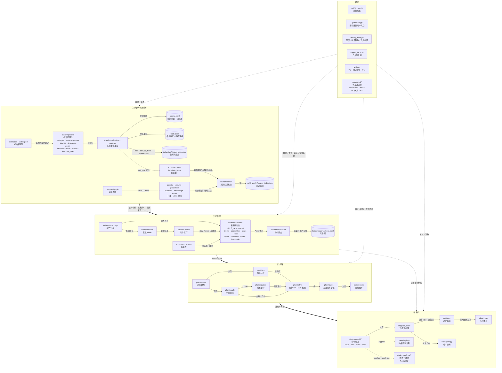

# 架构

五个阶段，每个阶段只消费前一个阶段的产物，不直接调用前一阶段的代码。

## 总图

## 读图规则

- 子图内部只画本阶段模块之间的关系，跨阶段一律用子图间箭头。
- 粗箭头是阶段推进，虚线是旁路读取或横切依赖。
- 阶段②有两条平行链：
  - 统计行：`loot/expect` 算每次触发的期望，`stats/importers` 产出统计行，`stats/model` 校验行形状，`store` 落成三个文件。
  - 来源索引：`sources/graph` 给出 `Rule` / `Graph`，`classify`、`closure`、`placement` 建立在它之上，`exposure` 与 `knowledge` 合成 `routes`，`drops` 与 `template_items` 提供掉落索引，三者汇入 `sources/index`。
- 阶段③的入口依赖阶段②的两份产物：`case/context` 读统计快照，`actions/build` 读来源记录，`recipes/facts` 与 `tags` 提供配方折算。
- 阶段③内部：`case/context` 到 `case/sources` 再到 `actions/build`；`gamedata` 提供标定值，`sources/constructs` 的能力成本也取自它。
- 阶段③对④只有类型依赖（`Action` / `Requirement`），没有运行期数据依赖。
- 阶段④内部：`plan/actions` 是底层类型，`tiers`、`supply`、`requires` 建立在它之上，`solve` 汇总三者。
- 阶段⑤：`grade` 与 `observe` 读 `actions.jsonl`，对目标取子图后调 `plan/solve`；`bg plan` 是唯一现场拼图的命令，走 `case/registry.builder_for()`。例外是 `grade --all` 与「超过 `JOINT_THRESHOLD` 件的清单」：这两条走整图求一次曲线再逐件取价（逐件子图 1.5 秒 × 1413 件 ≈ 35 分钟，整图一次约 6 秒）。整次口径的成本不在这份曲线缓存里——曲线只是叶子价，取整次成本仍逐件递归。
- 跨阶段的节点级依赖不画箭头。图上只保留三条主干（②到③、③到④、④到⑤）与③到⑤的读盘旁路；其余关系见各阶段的文字说明：②到⑤是 `bg stat` 的回退查询与 `bg plan` 的现场拼图，④到⑤是子图求解。
- 横切层不产出阶段产物：`paths` 提供目录，`mcshared` 还原语法，`units` 给 TU 与评分，`gamedata` 是游戏数据的唯一入口。

## 产物与命令

表中命令都要显式给地形包版本（`--pack-version` / `--pack` / `--label`）；`26.3` 只是示例。

| 产物 | 写入命令 | 输入 |
|---|---|---|
| `data/upstream/<pack>/` | `bg data sync` | 两个上游仓库 |
| `data/upstream/<pack>/` 校验 | `bg data verify` | manifest |
| `data/stats/<pack>/{meta,spatial,facts}` | `bg data ingest` | 采集侧运行目录 + 上游 facts |
| `facts.jsonl` 的 `loot_expectation` | `bg data loot` | 数据包战利品表 + `template.jsonl` |
| `build/<pack>/source_index.jsonl` | `bg index sources` | `graph.json` + 统计 + 知识表 |
| `build/<pack>/slots.jsonl` | `bg index slots` | 来源索引 + 配方 IR |
| `build/<pack>/actions.jsonl` | `bg index actions` | 来源索引 + 统计 + 配方事实 |
| 难度表与直方图 | `bg grade` | 落盘动作图 |
| 路线合成图（DOT/SVG/HTML） | `bg plan --graph-out` | 现场拼图的动作集 |

合成图默认走 `route_graph_ra`：图结构与渲染层照搬 RecipeAnalysis 的 `PathGraph` / `build_dot`（item 矩形、rule 菱形），本仓库只提供 `PathTree → PathGraph` 的 adapter 与 HTML 外壳（路线对照表）。**图上的成本与调用次数按整次调用口径**（`plan/whole.py`，与 `bg grade` 共用）：不可分割的动作写「整次调用 = 52.22 TU」，多趟才写「整次调用 ×12」，不会画成「单价 9.44 × 调用 0.54 次」。整次口径与均摊口径一样做 `once` 去重，但分两阶段：先解出树，再整树前序去重、自底向上重算（把「已付」并进缓存键会让 `elytra` 从 0.4 s 涨到 250 s）。HTML 的版式与 RA 对齐：标题下一行统计摘要（节点/动作/边/未画候选数），然后是图例、**生成参数、图**、路线对照表。「生成参数」块（`options.RunInfo`）在**图之上**用 grid 铺开全部生效参数，并附一条可直接重跑的命令与输入指纹（动作图条数 + 统计摘要）——沿用 RA `PathOptions.describe()` 的原则：**写全、不写「与默认值的差」、不折叠**，图脱离命令行传阅时也能复算。图例只留读图必需的几条，固定成本去重、深度截断、回边等一次性说明收进 `
`。旧的单层节点渲染器 `route_graph.py` 与 `--graph-legacy` 已于 2026-11-25 删除。HTML 另附「前置替换成本」表（`--graph-frontiers`）：禁用某前置当前的来源后**重新求解整条路线**，差额含固定成本去重与多级依赖的真实变化。图里也可以直接画上游候选（`--graph-branches` / `--graph-branch-ratio` / `--graph-max-nodes`）：默认每个物品画最优 + 2 个备选、只画贵不到 1.5 倍的，超出上限的数量画成橙框虚线节点。**没画出来的东西一律留痕**：物品还有别的来源时挂「还有 N 条候选」，`--graph-paths` 截掉的整条路线挂在 target 上写「还有 N 条路线」，tooltip 与 HTML 表格下都列出明细（名次、动作、成本比）——否则读者会以为图上就是全部候选（`diamond` 实测 19 条路线，默认只画 3 条）。候选与最优的倍数按**本次在这个位置需要的件数**算，不是按曲线第一段（曲线只按「拿 1 件的全价」排序，拿 10 件时最便宜的可能换人）：主路线已经在用的那条来源不会再被当成「第二来源」重画，红色也不会被候选刷淡。依赖回到自己的上游候选不画（`diamond` 的「钻石块分解」要经过 `diamond_block`，而钻石块又要钻石合成，画出来只剩一个没有入边的合成节点），只在虚线节点的 tooltip 里注明「依赖自己」。已经画出来的路线里遇到回边时，画成不参与层级计算的虚线，表示这一步要用的东西本页正在造，那一份按该物品的最优价计。

**整次口径只有一个入口**：`plan/whole.py::whole_choice`（单目标）与它上面的 `best_bundle`（多目标一次买齐）。`bg plan`、合成图、`bg grade` 的单件成本、`bg grade --together` 的前置定价与 `once` 去重全部走这一份递归；`--together` 只额外负责「一个动作同时供给多件」那层枚举。此前这三处各有一套取整与去重规则（`--together` 甚至不用引擎曲线），已收敛（见 [`model/gap-register-minor.md`](model/gap-register-minor.md) S5/S7）。JSON 字段名也统一了：`cost_tu` 一律是均摊口径，整次口径一律叫 `whole_cost_tu`。

`data/upstream/`、`data/stats/` 与 `build/` 都不入库：前者由 `bg data sync` 重建，中者由 `bg data ingest` 与 `bg data loot` 重建，后者是运行产物。

## 分层边界

- 成本公式只在 `case/sources/` 与 `plan/`；`stats/` 只存事实，`sources/` 只翻译，`plan/` 只择优且不做 IO。
- 新增 stat_type 必须归入 `SPATIAL_TYPES` 或 `FACT_TYPES`，`stats/model.py` 末尾有断言；`resolver` 只服务前者。
- 未接通的数据必须记账，不能静默丢弃：动作层记 `uncovered`，构建层记 `missing_prereqs` 与 `no_action_items`，导入层记 `gaps`。
- 改动后的重跑顺序：`stats/`、`bg data loot`、`bg index sources`、`bg index actions`。只改知识表注释也要重跑 `bg index actions`，输入指纹覆盖它。
